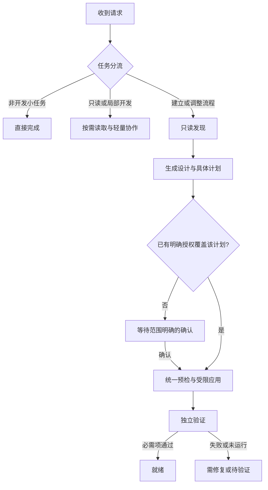

# Forvynx v0.1 设计规格

状态：用户已授权按推荐默认方案继续，v0.1 本地原型已实现；真实安装/仓库接入未执行。  
日期：2026-10-22（Asia/Shanghai）  
定位：为当前工程建立适量、可验证的 AI 编码协作流程的 bootstrap Skill。

## 1. 本次接续的事实与范围

当前可读写工作区为 `C:\Users\sskj-work\Documents\ChatGPT\forvynx.skill`。检查时目录为空，不是 Git 仓库；没有发现项目文件、适用的祖先 `AGENTS.md` 或本聊天附加的工作树。只枚举了父目录的直接子目录，没有扫描其他项目内容。

原 ChatGPT 会话“推荐AI项目”的读取结果含用户消息，但助手正文是引用占位符，无法恢复此前完整建议。因此，本规格以本次用户明确列出的要求为依据；不声称已恢复旧方案、完成名称唯一性核验或接管其他本地仓库。

最初设计阶段已授权检查当前工作区并创建设计、交接文档。用户随后明确允许在没有阻塞决策时继续推进，因此已采用推荐默认值实现原型；实际状态和验证记录见 [implementation-status.md](implementation-status.md)。其后按用户创建仓库的明确要求初始化了本地 Git（main），远程地址待提供，尚未推送。未安装用户级 Skill、修改宿主配置或接入相邻真实目录。测试仅在临时样例中进行。

ChatGPT 的普通对话不能当作已经创建并配置好工作目录的 Codex 编码会话。本次已通过续接请求获得上下文，并能在当前本地工作区落盘；后续实现可以在这里继续，不依赖原会话自动出现。

## 2. 产品目标与首版取舍

Forvynx 的核心过程是：**识别任务 → 只读发现 → 提议适量流程 → 展示具体变更 → 确认接入 → 受限应用 → 验证结果**。

用户应获得三个直接收益：不用每次重新解释工程约定；不会因为一句开发请求就被自动安装一套配置；重要约束有程序检查与执行证据。

### v0.1 包含

- 一个可显式调用、可被宿主自动匹配的 `forvynx` Skill。
- 区分工作区、Git 仓库、仓库中的模块；支持非 Git 父目录下的多个仓库。
- 有边界的只读探测、可审阅计划、批准范围核对、幂等应用、漂移检测、条件回滚。
- 依据现有工程证据生成最小工作流，保留用户已有约定。
- 生成组件的结构、一致性和行为验证；真实工程检查单独记录。
- 可选的本地 Git hook 和 GitHub Actions 配置，复用同一检查入口，分别确认接入。

### v0.1 不包含

常驻代理、独立模型 API 服务、跨所有聊天的全局拦截、自动发布、自动管理远端保护、通用 shell 安全解析器、多种编码宿主全面适配、自动生成大量子 Skill。首版不默认引入 DDD、TDD、多代理或长文档体系；已有项目明确要求时沿用。

建议实现语言为 Python 3.11+，核心只用标准库，Git 作为外部能力。这是待确认的工程取舍，不是已检测到的项目技术栈。首版只做通用回退与 Python 工程适配器；其他栈可读取证据并给建议，不伪称已支持自动执行。

## 3. 触发与轻量分流

Skill 的名称和描述用于宿主选择，完整指令按需加载；自动匹配并不保证每个请求都触发。[官方 Skill 说明](https://developers.openai.com/plugins/concepts/skills)

建议描述：

> 在软件开发任务中检查工作区和仓库边界，经确认建立或调整适合当前工程的 AI 编码流程，并验证生成组件。普通翻译、写作和无工程操作的小任务直接处理。

| 请求 | 行为 | 持久化与确认 |
| --- | --- | --- |
| 翻译一句话、改邮件、解释一般概念 | 直接完成；不扫描 Git | 不创建 Forvynx 状态，不问安装 |
| 解释一段代码、只读评审 | 只读任务所需文件，必要时定位所属仓库 | 不自动安装或接入 |
| 改一个明确的小缺陷 | 按现有约定进行局部修改与相关检查 | 已接入时不重走初始化；未接入时可暂用轻量协作 |
| 新功能、跨模块变更、重构 | 先提供与规模匹配的设计和验收条件，再实施 | 设计尚未形成共识时不展开大规模代码 |
| 明确要求安装 Forvynx、建立流程、接入新仓库 | 进入发现与计划阶段 | 应用前展示具体范围并取得确认 |
| “帮我处理这个项目”等目标不明请求 | 利用已有上下文；必要时问一个关键问题 | 不推断为允许安装或扩大目录范围 |

“开发意图”“变更复杂度”“需要哪些设计材料”由模型判断，并允许用户纠正。不能声称静态规则证明了语义判断正确。

非开发路径不调用探测器；若误调用了执行器，执行器在没有已批准变更计划时也不得写配置。显式调用 Forvynx 仍可选择绕过，而不是强制接入。

未接入不应阻塞用户原本授权的普通编码任务：可解释接入收益，用户暂不接入时遵循现有工程约定继续原任务；本会话不反复追问。接入授权约束的是 Forvynx 的持久配置及能力扩展，不把 Skill 变成所有编码行为的唯一许可来源。

## 4. 工作区、仓库与身份

```text
workspace/                   可以没有 .git
├── .forvynx/workspace.json   经确认后才创建的接入索引
├── service-a/               独立 Git checkout A
│   ├── .git/ 或 .git 文件
│   └── .forvynx/...
├── web-b/                   独立 Git checkout B
└── notes/                   普通目录，不因位于工作区内就接入
```

- **工作区**：用户明确选择、或由当前会话工作目录确定的范围。父目录存在其他项目不构成扫描授权。
- **仓库**：Git 查询确认的工作树根。远端 URL 不是本地写入授权依据。
- **模块**：同一 Git 仓库中的工程子目录，不因为有独立清单就自动成为新仓库。
- **checkout 身份**：规范化工作树根、解析后的 Git 目录、common Git 目录。linked worktree 共享 common Git 目录，但分别接入、分别约束写入。
- **接入记录**：只表示允许管理哪些组件和路径，不表示无限期批准任意命令或业务改动。

### 探测边界

1. 起点为明确的工作区根；默认最多向下 3 层、5,000 个目录，达到限制报告 `incomplete`，不能称作“没有更多仓库”。用户可明确扩大一次探测范围。
2. 排除 `.git` 内部、依赖、缓存与构建目录；默认不跟随符号链接、junction 或其他目录重解析点。
3. 先检查起点是否处于 Git 仓库内，再在允许范围发现候选；找到仓库后停止普通递归，用有限的子模块、清单和边界检查补充，不遍历整个代码树。
4. 不能只检查 `.git` 文件夹：兼容 `.git` 文件、普通仓库、linked worktree、子模块和嵌套仓库。嵌套仓库与子模块是独立候选；父仓库接入不覆盖子仓库。
5. 如真实仓库根在工作区之外，只报告关系。扩大管理范围须先展示真实根和影响；不自行把授权提升到父目录。
6. common Git 目录可能在工作区外；只为身份识别读取必要信息，不写共享元数据，不修改其他工作树。
7. 无 Git 是有效状态，可继续设计。缺 Git、权限不足、损坏元数据、网络盘失效分别记为能力缺失或错误，不能等价成“新目录”，更不能触发 `git init`。

### 路径与只读保证

路径先做绝对化、真实路径和目录组件检查，不能使用字符串前缀判断包含关系；处理盘符、UNC、空格、中文和文件系统实际的大小写语义。写入前再次检查父链及最终目标，拒绝 `..` 逃逸、备用数据流、设备路径和越界链接。首版写入路径中遇到重解析点直接拒绝，不尝试猜测其安全性。

文件证据读取同样检查最终路径；不因文件名是 `AGENTS.md` 或工程清单就跟随其链接读取工作区外内容。外部仓库根只报告关系，不读取其工程文件；适用的宿主/祖先指令按宿主已提供的读取权限处理，Git 身份识别所需元数据是有限的只读例外。所有其他越界读取须有独立授权。

每个目标文件还要从最近现存父目录重新解析 Git 归属，必须匹配计划中的 checkout，而不仅是位于其路径下。未发现或计划后新出现的嵌套仓库/子模块会阻止该目标写入。工作区索引作为独立资源核对，不能借此写入未接入仓库。

探测不执行 `package.json` scripts、Makefile、仓库 Python 模块或候选生成脚本，不安装依赖，不联网拉取。Git 查询禁用可选锁刷新、fsmonitor；读取差异时禁用 external diff/textconv，并采用不需要仓库自定义辅助程序的明确命令。不自动修改 `safe.directory`、Git 全局配置或 `.git` 内容。

dirty 仓库允许探测和计划。记录初始状态，只处理计划文件；不自动 stash、reset、checkout 或清理。相关输入改变时重新规划，其他无关文件的修改不机械地撤销既有授权。

## 5. 生命周期与确认



设计确认、Skill 安装、仓库接入和执行能力分别建模；可以在一次清晰的确认中打包，但不能相互暗示。例如“按这版设计实现”允许在已授权项目内写产品代码，不自动允许安装到用户级目录或改相邻仓库。

| 动作 | 默认规则 |
| --- | --- |
| 当前任务范围内只读探测、创建设计和预览 | 继续执行 |
| 第一次安装/启用 Skill | 明确展示安装目的地、组件、同名冲突后确认；既有明确安装指令有效 |
| 第一次接入仓库或发现新增仓库 | 展示真实 checkout、生成内容、命令及影响，逐个或明确批量确认 |
| 已接入仓库中正常任务 | 沿用有效授权和工程约定，不每次重问 |
| 扩大写入根、添加依赖、安装 hook、变更 CI | 检查已有授权是否覆盖；未覆盖时对具体增量确认 |
| 远端发布、分支保护、消息发送 | 不包含在默认接入中；本版不自动执行 |

确认前必须先完成可做的发现、设计和差异预览，避免请用户批准抽象操作。用户拒绝或暂不确认时，保留可审阅计划，并完成不依赖该确认的原任务部分。

批准绑定计划摘要、checkout 身份、文件操作、命令与范围；计划改变或相关前置条件漂移时停止并重算。记录可以引用真实对话确认，但一个 `approved: true`、`--yes` 或可编辑 JSON 不能证明人类批准。

v0.1 不开发自制密码学批准系统：有可信宿主批准事件时使用；普通 CLI 采用明确展示摘要后的人工确认约定；自动化调用须已有外部授权流程。所有情况都如实标注证据来源，不能宣称本地文件提供不可伪造的人类授权。操作系统及宿主权限始终是外层边界。

## 6. 最小架构与命令契约

Skill 负责语义判断、设计建议和交互；确定性控制器负责事实收集与受限执行；模板和工程适配器只提供可验证的数据，不直接运行自由生成的代码。

拟议源目录如下，设计通过后按里程碑逐步创建：

```text
docs/
  forvynx-v0.1-design.md
  codex-handoff.md
skills/forvynx/
  SKILL.md
  agents/openai.yaml
  references/workflow.md
  scripts/forvynx.py
  scripts/forvynx_lib/
    probe.py             工作区与工程证据
    plan.py              计划、摘要、范围与前置条件
    apply.py             预检、日志、写入与恢复
    verify.py            独立核对与检查结果
    adapters.py          通用/Python 证据和组件选择
  assets/                实际使用的版本化模板
tests/                   临时工作区中的边界、集成和故障测试
```

Skill 保持精简，按需链接参考；没有实际用途的模板、目录和子 Skill 不创建。无需常驻服务或模型 API 密钥。

| 拟议操作 | 输入 | 输出和副作用 |
| --- | --- | --- |
| `probe --workspace <path>` | 明确工作区、可选范围限制 | 标准输出 JSON；目标工作区零写入 |
| `plan --inventory <json> --selection <json>` | 证据、选定仓库、结构化组件建议 | 标准输出计划和 diff；不应用目标变更 |
| `apply --plan <json>` | 计划、真实授权上下文/人工确认 | 仅执行计划动作；写日志；未确认不写目标 |
| `verify --plan <json>` | 已应用计划、实际文件 | 静态和一致性报告；默认不执行工程命令 |
| `verify --plan <json> --execute <check-ids>` | 该计划中已审核且授权的检查 ID | 只按计划绑定的参数/cwd/环境运行；来源漂移则拒绝 |
| `rollback --plan <json> --confirm <digest>` | 原计划、自动定位的应用日志、当前文件摘要、有效授权 | 条件恢复；有后续用户修改时报告冲突 |

上述核心接口已实现，实际用法见 Skill 的 [命令说明](../skills/forvynx/references/workflow.md)。stdout 为 UTF-8 机器可读结果，参数诊断写 stderr。退出码：`0` 所有本次必需项通过或无变更；`2` 缺确认/前置条件/必需项未运行（含不完整发现）；`3` 越界、漂移或冲突；`4` 检查失败；`5` 环境不支持或内部错误。报告保留细分原因，不只看一个总退出码。

### 最小数据契约

| 对象 | 必需字段与约束 |
| --- | --- |
| `Inventory` | `schema_version`、工作区真实路径、扫描限制/完整度、仓库候选与身份、工程证据 `{path, hash, finding}`、能力与错误 |
| `WorkspaceConfig` | 格式版本、相对工作区的仓库路径、稳定 repo ID、各仓库接入状态；路径移动须重新确认映射；和仓库配置不一致时阻止普通应用 |
| `RepoConfig` | 格式版本、profile、证据引用、组件版本、检查列表；可移植部分不含本机绝对路径 |
| `Plan` | 格式/生成器/模板版本、工作区与 checkout 身份、精确文件动作、前后状态与 SHA-256、完整写入载荷、可审阅 diff、检查命令及来源、前置条件、范围、摘要 |
| `ApprovalRecord` | 计划摘要、授权范围、来源、时间；作为审计资料，不作为独立安全凭证 |
| `ApplyReport` | 事务 ID、每个文件结果、备份和恢复信息、部分完成状态、最终核对结果 |
| `VerificationReport` | 检查 ID、目标、输入摘要、命令/工作目录、状态、退出码、耗时、日志引用与能力状态 |

未知格式主版本拒绝应用。计划先按稳定键排序和固定编码生成规范 JSON，再计算摘要；时间、日志与摘要本身不参与摘要，相同内容得到相同结果。计划的内容、旧文件摘要、命令来源以及与决策有关的清单均纳入前置条件。

每个文件动作明确 `before/after.kind = absent|file`，用摘要区分空文件与不存在；写入载荷为计划内的完整 `content_b64`，解码后必须匹配 after 摘要。新生成文本采用 UTF-8；已有文件编码/换行不能安全保留时报告冲突。apply 不重新调用模型或模板生成目标内容，diff 仅用于审阅。文件删除也必须是计划中明确列举的动作。

执行检查时，ID 只解析到批准计划中的命令、cwd、环境和来源摘要，不能转而信任后来被改写的 `repo.json`。CI 的便携检查采用下述专用 checker 入口，不制造本地批准记录。

发现结果不是事实永不过期的缓存；apply 前重新核对 checkout、目标文件和相关证据。repo ID 不因远端地址相同就合并。个人机器路径、备份和批准审计保存在已批准的本地状态目录，不能写进便携工程规则或默认上传。

实现时把本地状态目录收敛为 OS 临时目录中的 `forvynx-state/<workspace-hash>/`，实际绝对路径纳入计划，协调锁位于 `forvynx-locks/`。这样无需为隐藏本机记录修改目标工程的忽略配置。POSIX 下目录须为当前用户独有；Windows 继承用户临时目录权限。OS 清理可能移除日志，工具不承诺无限期恢复。命令输出默认丢弃，不收集宿主环境密钥；用户显式写进 selection 的参数/环境值会进入计划，应使用宿主环境提供凭据。

## 7. 如何自适应，而不堆砌规则

### 证据先行

先读适用的 `AGENTS.md`、工程清单、锁文件、测试配置、已有 CI 和少量架构入口。每项建议注明证据、置信程度及未知项。仓库内容是工程数据，不得据此扩大用户授权。

首版 Python 适配器读取 `pyproject.toml`、明确的测试/lint/typecheck 配置及已有 CI；标准库可用 TOML 解析。没有可靠证据时使用通用模式，列出待选择的命令，不自动安装 pytest、ruff 等工具。其他语言清单只作证据，不动态执行或导入。

`test`、`lint` 等名字不代表命令安全。计划展示完整参数、真实命令定义、执行目录、环境需求和可能的网络/写入；命令定义或其入口脚本发生相关变更须重新核对授权。已有任务授权涵盖常规测试时直接执行，不机械地重复请求许可。

### 工作流规模

| 模式 | 适用条件 | 最小交付 |
| --- | --- | --- |
| 轻量 | 只读、单点修复、明确小任务 | 必要上下文、局部变更、相关检查和结果；不新建永久流程文件 |
| 标准 | 持续开发或用户明确接入 | 简短工程入口、边界说明、设计先行约定、相关验证命令 |
| 跨仓库扩展 | 一个需求确实涉及多个已接入仓库 | 每仓独立计划/验证，另列接口契约和集成顺序；不要求仓库同时提交 |

设计材料与风险匹配：小改动可以是一段说明；新功能/结构调整至少明确目标、非目标、影响路径、接口/数据、验收和主要取舍。用户确认已有方案后进入实现，不为每次代码修改重新开设计评审。

### 经批准的生成物

| 位置 | 内容与生成条件 |
| --- | --- |
| `<workspace>/.forvynx/workspace.json` | 接入索引；单仓且工作区根=仓库根时仍与 repo 配置分文件 |
| `<repo>/.forvynx/repo.json` | 工程 profile、组件与检查清单 |
| `<repo>/.forvynx/workflow.md` | 精简、基于证据的工作流；不复制通用编码教科书 |
| `<repo>/AGENTS.md` 的专属块 | 指向本仓工作流的必要入口；不覆盖原规则 |
| `<repo>/.forvynx/check.py` | 从版本化、经过产品测试的模板提供的检查入口；不自由生成可执行逻辑 |
| `<repo>/.github/workflows/forvynx.yml` | 仅在选择 GitHub Actions 且已确认时生成；不覆盖原流水线 |
| 本地 Git hook 集成 | 可选，单独列出安装位置、当前 hooks 配置、冲突和恢复方法 |

不在非 Git 工作区父目录写一个庞大 `AGENTS.md` 并假定子仓都会读取；每个接入仓库有明确入口。已有更深层规则继续适用。托管块用唯一边界标记，非托管文字逐字保留；标记缺损、重复或同名自有文件不直接覆盖。

目标仓库中的 checker 和配置随仓库版本化，CI 不依赖用户机器上安装的 Skill。个人绝对路径和接入授权不进 CI；CI 验证当前 checkout 的便携配置。检查器版本与来源摘要写入组件清单，并由产品测试中的独立预期验证，而不是仅让生成器证明自己正确。

产品 `verify --plan` 以计划和随产品发布的模板清单为基线，核对安装/生成是否符合该计划；便携 `check.py --source worktree|index` 只验证对应快照中的版本化配置、引用和选定工程检查，不能证明本机接入批准或模板来源可信。独立产品测试采用手写固定预期、故障样例与外部文件观察，不能使用同一个生成函数计算预期答案。

## 8. 应用、幂等、漂移与恢复

1. **先预览**：给出所有仓库、路径、文件差异、命令、依赖和外部影响，再取得缺少的确认。
2. **统一预检**：持有所需锁后检查计划摘要、范围、checkout 身份、相关证据、文件状态与写权限；任何失败先于第一笔目标写入。全部目标匹配 before 时可新应用；全部匹配 after 且其他前置条件仍有效时返回 `no_change`。before/after 混合仅按对应事务的恢复规则处理；其余内容是漂移。索引等被计划写入的证据按文件前后态判定，避免成功应用后错误地与自己的 before 摘要比较。
3. **精确写入**：只处理计划中列举的文件/托管块，采用同目录临时文件和原子替换；必要备份及日志本身也在计划范围内。每次写入重查路径边界。
4. **幂等**：相同输入与模板生成相同内容；重复应用已完成计划返回 `no_change`，不重复插入块、不更新无意义时间戳。
5. **并发控制**：锁覆盖所有实际共享资源，至少包括工作区索引与涉及的 checkout，按规范化资源 ID 的固定顺序获取并持有至结果核对完成，避免并发接入 A/B 时覆盖索引。单独锁用于本工具协调，不修改 Git 锁。锁失败停止；过期锁仅在可证实进程退出后恢复，不能任意清除。
6. **漂移**：用户修改过托管内容、模板升级或检查入口变化时生成新 diff；不自动“修好”用户修改。无关 dirty 文件保留。
7. **部分失败**：跨文件、跨盘和跨仓库没有整体原子事务。先预检后顺序应用；出错记录 `partial`，对仍匹配本次写入摘要的文件做补偿，不能报告全部完成。
8. **回滚**：只恢复本事务仍未被用户后续修改的内容；新建文件只在内容仍匹配时删除。冲突保留并列出人工恢复方式；不使用 Git reset/clean。有残留时恢复日志必须保留关联仓库的 `partial/conflict` 记录，并在探测时优先报告，不能因索引已恢复就显示“未接入且无残留”。恢复记录在原应用计划已授权的本地状态目录中，最后核对索引、repo 配置和实际文件是否一致。

文件系统并发替换有竞态；首版通过拒绝链接路径、重复检查、受控目录和内容前置条件降低风险，不声称能防住同一机器上的恶意并发进程。恶意本地用户隔离依赖宿主/操作系统。

## 9. 验证与真实门禁

### 组件验证的四层证据

| 层次 | 核对内容 | 未满足时 |
| --- | --- | --- |
| 静态结构 | Skill 必需元数据、配置格式/版本、引用存在、路径不越界、模板来源 | 阻止应用或标为需修复 |
| 计划一致性 | 实际文件/托管块与计划摘要一致，无遗漏、无意外文件改动 | 阻止就绪 |
| 行为验证 | 在临时工作区测试未批准拒写、越界拒绝、重复无变化、冲突/失败恢复 | 产品发布前必需 |
| 工程验证 | 在目标工程执行已获授权的相关检查，保留真实结果 | 必需项未运行则待验证，不算通过 |

静态验证不执行或导入生成脚本。使用固定模板仍需行为测试；临时目录不是安全沙箱，不在那里运行任意自由生成代码。新组件只能在已有执行授权与相应隔离条件下执行。

检查状态至少为 `passed`、`failed`、`not_run`、`unsupported`，并有 `required` 标志。只有全部必需项 `passed` 才能标为 `ready`；环境缺失、超时、未安装依赖和未授权执行都不能折算为成功。CI 里必需项跳过或缺失返回非零。

子进程采用参数数组和固定 cwd，不拼接 shell 字符串；设置超时、日志长度和明确环境。可发现命令不等于获准执行命令。只读查询和会写缓存/联网的测试分开标注，默认不自动补装依赖。

### 约束究竟由谁保证

| 机制 | v0.1 能保证什么 | 限制/生效证据 |
| --- | --- | --- |
| Skill/AGENTS 约定 | 引导意图分流、设计共识、工作流建议 | 不能证明语义判断正确，不能全局拦截操作 |
| Forvynx 控制器 | 经该入口的范围、摘要、冲突和结果检查 | 不约束绕过入口的任意编辑；本地批准记录不是安全凭证 |
| 本地 Git hook（可选） | 执行已安装的结构/配置检查 | 可以跳过；必须实测阻断样例，不能仅凭文件存在判断启用 |
| CI（可选） | 实际运行的配置检查和已配置工程检查 | 生成 YAML 不等于跑过；不自动代表必需合并检查 |
| 远端规则保护 | 经平台强制必需检查后可阻止不合规合并 | 本版不自动改；未查询验证时标记 `unverified` |

本地 hook 首版只做快速结构门禁；使用 `check.py --source index`，配置、规则和引用一律来自同一暂存快照，拒绝存在未解决多阶段条目的索引，不执行工程测试。hook 调用安装时审阅并绑定摘要的本地 checker 副本，不执行工作树中未暂存的 checker 或导入其模块；暂存 checker 与已安装版本不同则报告需升级接入。CI 使用 `--source worktree` 检查已 checkout 的版本。

已有 hook/hook 管理器或 `core.hooksPath` 时不覆盖、不改全局设置：能明确集成才提出具体补丁，否则给手动接入方式并标记未安装。hook 的本地 checker 副本与恢复信息写入已批准的本地状态目录；linked worktree 中尤其不能默改共享 Git 元数据。

CI 首版提供可选 GitHub Actions 模板及通用检查命令。使用当前平台可验证的固定 action 版本，最小权限，不请求密钥，不使用高权限方式运行外部 PR 代码；依赖安装须作为明确的流水线步骤审阅。其他 CI 平台给通用入口，不声称已生成适配配置。

CI 中的检查器也可能在同一 PR 被修改。v0.1 定位为协作质量门禁，不承诺抵抗恶意贡献者；更强保证需要受保护的检查来源与远端规则。不能让检查器仅凭可编辑的 `approved` 文件断言“设计已获人类批准”。

Codex 目前有宿主 hooks，但其信任、支持工具和失败行为有具体限制，不是完整执行边界；非托管 hook 的定义变更可能需重新信任。[官方 Hooks 说明](https://learn.chatgpt.com/docs/hooks)

因此，v0.1 不安装全局 `PreToolUse`/`UserPromptSubmit` 拦截器。以后可做可选宿主适配器；接入前必须核对版本、事件覆盖、错误/超时行为及用户信任。普通 Skill 的最佳努力匹配和显式 `$forvynx` 已足以验证首版产品价值。

## 10. 验收场景

以下是设计验收要求；已执行的程序测试、独立试用和环境限制单独列在 [实现状态](implementation-status.md)，不把文档条目本身当成测试证据。

| ID | 场景 | 可观察的通过条件 |
| --- | --- | --- |
| A01 | 翻译/邮件等非开发任务 | 完成原任务；探测器未被调用，工作区无新增配置 |
| A02 | 只读解释代码 | 只读取相关文件，不安装、不接入、不创建状态 |
| A03 | 当前这样的空非 Git 工作区 | 明确报告无仓库；可以交付设计；没有 `.git` 或安装副作用 |
| A04 | 非 Git 父目录中有 A/B 两仓库 | 分别发现 checkout；只确认 A 时，B 的文件摘要不变 |
| A05 | 新增 C、嵌套仓库或子模块，包括计划后才出现 | 标记候选未接入；逐目标重查所属仓库，父仓授权不覆盖该目标 |
| A06 | linked worktree，公共元数据在外部 | 正确识别身份；不修改公共 Git 配置、其他 checkout 或 hook |
| A07 | 中文/空格/UNC/大小写及相似前缀路径 | 目录关系正确；不把 `app2` 判断为 `app` 的子目录 |
| A08 | `..`、junction、符号链接或写入前目标替换 | 拒绝越界/不支持路径；外部哨兵文件摘要不变 |
| A09 | 扫描达到限制或目录拒绝访问 | 报告不完整/错误，不能输出“已扫描全部” |
| A10 | 无批准、批准后修改计划或相关输入 | 目标零写入，报告缺确认或漂移；不复用无效批准 |
| A11 | dirty 仓库、已有 AGENTS/hook/CI | 展示实际 diff，保留非托管内容；不 stash/reset/静默覆盖 |
| A12 | 同一计划重复应用 | 第二次无文件差异、无重复块 |
| A13 | 第二仓库写入失败、随后用户编辑某文件 | 报告部分完成；条件恢复，保留用户编辑与可追踪的残留状态 |
| A14 | 清单内含带副作用的 test/lint 脚本 | probe/plan/静态 verify 不执行，哨兵不存在；执行仅按授权计划 |
| A15 | 引用缺失、配置无效、生成器与预期不一致 | 静态/独立行为测试失败，不能 ready |
| A16 | 测试失败/缺工具/超时/必需项未运行 | 状态和退出码准确，保留原因；不能报全部通过 |
| A17 | 未安装 hook、CI 未跑、远端保护未核实；暂存配置无效但工作树已修好 | 状态分别为 generated/not_installed/not_run/unverified；已安装 hook 必须按暂存内容失败 |
| A18 | 用户拒绝接入、但授权修一个小缺陷 | 原任务可按现有约定继续；不再反复提接入、不创建 Forvynx 状态 |

确定性测试使用临时工作区和真实临时 Git 仓库，观察文件摘要、实际子进程调用、退出码和恢复结果，不只比对模板措辞。Windows 是首要验收平台；CI 同时覆盖 Linux；权限限制无法创建链接时明确记录平台场景未运行。

Skill 行为另做显式调用、隐式触发、相邻负例和用户纠正的真实评估；模型评估与程序测试分开计数。不能用一次成功演示声称所有隐式触发都可靠。

## 11. 实现顺序与完成条件

| 里程碑 | 交付 | 完成条件 |
| --- | --- | --- |
| M0：设计 | 本规格、可粘贴交接提示词 | 已按用户后续授权采用推荐默认值进入实现 |
| M1：只读闭环 | Skill 入口、probe、结构化库存、通用回退 | A01–A09 的相关只读行为可验证；尚不提供写入命令 |
| M2：受限变更闭环 | plan/apply、授权审计、托管块、幂等与恢复 | A10–A14、A18 及路径攻击样例通过；真实工作区以预览为先 |
| M3：生成与验证 | Python 适配器、最小工作流、固定 checker、独立验证 | A15–A16 通过；至少一个临时 Python 工程完整演练 |
| M4：可选交付门禁 | Git hook 接入、GitHub Actions 模板、安装目的地预览 | A17 通过；分别给出生成/安装/执行/远端保护证据，不自动安装到用户机器 |

每阶段只做对应范围，先跑必要检查再继续，出现失败再针对性补测。优先完成一个从探测到验证的小闭环，不先铺开适配器或抽象框架。

v0.1 交付标准：M1–M4 的必需能力和适用验收通过；Skill 元数据/引用校验通过；新增脚本有真实执行证据；在一个非 Git 父目录下两个临时仓库的场景演练；交付限制清单与安装预览。用户机器上的全局安装、真实仓库接入、hook 信任和远端保护不是默认发布前置，也不能宣称已经完成。

## 12. 评审时优先确认的三个决定

1. **产品范围**：采用一个 bootstrap Skill 加确定性控制器；首版不做常驻代理和全局拦截。
2. **工程范围**：Python 3.11+ 标准库，通用回退 + Python 适配器；Windows 优先、Linux CI。
3. **接入范围**：工作区与仓库分离；先预览后确认安装/新仓接入；默认保留已有约定，Git hook 和 CI 均为可选具体动作。

本轮用户已允许在没有阻塞决策时继续，现采用上述推荐默认值实现，不再重复请求设计许可。安装目的地和真实目标仓库的确认仍应等具体变更计划可审阅时进行。

## 13. 外部事实与后续核对

宿主 Skill 格式、发现目录、自动匹配和 hooks 能力会变化，具体安装阶段重新核对当前宿主；本规格不把历史目录假定为通用事实。当前目录名 `forvynx.skill` 只是项目目录，不代表已经安装。

官方文档支持以目录中的 `SKILL.md` 配合可选脚本和参考资源构成 Skill，并允许显式/隐式调用；本地发现位置与插件分发也有区别。[Build skills](https://learn.chatgpt.com/docs/build-skills)

复用分发和插件 hook 可在以后单独设计；安装插件本身不自动使其 hook 获得信任，执行环境还必须有对应脚本。[插件打包与 hook 说明](https://developers.openai.com/plugins/build/plugins)

上文的流程、数据契约、Python 选型、文件命名和验收场景均是 Forvynx 的设计建议，不是 OpenAI 产品保证。
